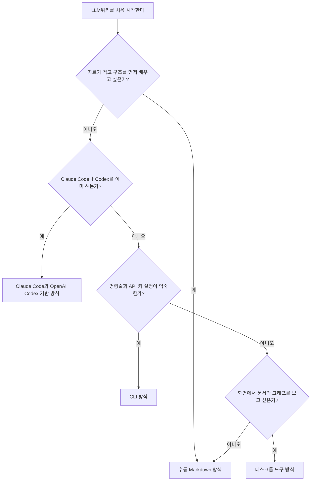
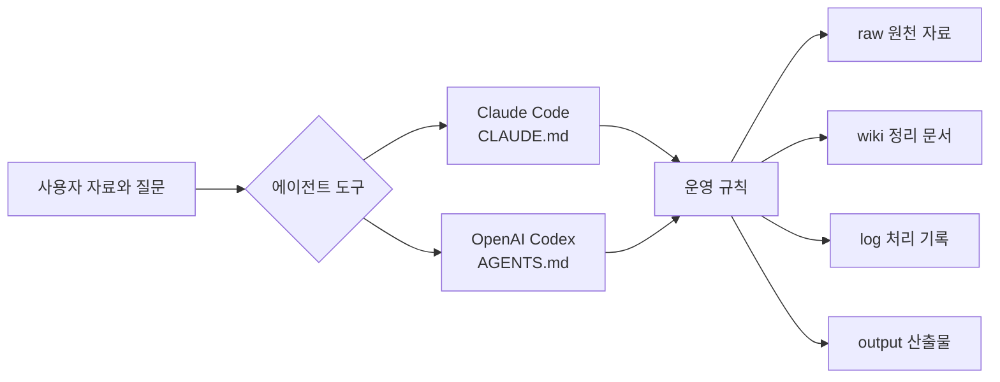
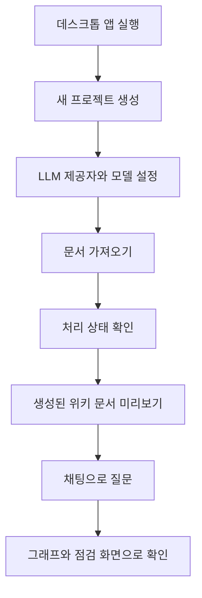

1. [**LLM위키 완벽 가이드**](https://wikidocs.net/book/19830)
2. [3장. 내게 맞는 LLM위키 방식 고르기](https://wikidocs.net/353385)
3. [3.1 시작 방식 비교하기](https://wikidocs.net/353386)

1. [위키독스](https://wikidocs.net/)

# 3.1 시작 방식 비교하기[맨위로](https://wikidocs.net/353386\#top "맨위로")

광고가 출력될 위치입니다.


광고가 출력될 위치입니다.


# 3.1 시작 방식 비교하기


LLM위키를 시작할 때 가장 중요한 선택은 “기능이 가장 많은 도구”가 아닙니다. 이번 주 안에 작은 자료 하나를 넣고, 정리된 문서 하나를 만들고, 그 문서로 질문까지 해 볼 수 있는 방식이 더 중요합니다.

이 절에서는 시작 방식을 세 가지로 나눠 비교합니다. 먼저 수동 Markdown 방식으로 구조를 익힙니다. 그다음 Claude Code와 OpenAI Codex처럼 이미 쓰는 LLM 에이전트 도구에 붙이는 방식을 봅니다. 마지막으로 CLI와 데스크톱 도구를 확장 선택지로 살펴봅니다.

이 절의 목표는 도구의 순위를 정하는 것이 아닙니다. 독자가 자신의 상황에 맞는 첫 선택을 할 수 있게 돕는 것입니다. 첫 선택은 언제든 바꿀 수 있습니다. 수동 Markdown으로 만든 위키를 나중에 Codex나 Claude Code로 다듬을 수 있고, CLI가 만든 Markdown 파일을 데스크톱 앱이나 Obsidian에서 열어 볼 수도 있습니다.

> 이 절의 도구 명령 예시는 2026-05-16 KST에 확인한 문서를 기준으로 합니다. LLM위키 구현체는 빠르게 바뀌므로, 실제 실행 전에는 GitHub README, Releases, 설치된 도구의 도움말을 다시 확인하세요.

**학습자료: 시작 방식 선택 흐름**



이 흐름도는 처음 고를 방식을 좁히기 위한 자료입니다. 처음에는 수동 Markdown 방식이 가장 안전합니다. 구조가 눈에 보이고, 실패해도 원인을 찾기 쉽기 때문입니다. 이미 Claude Code나 Codex를 자주 쓴다면 에이전트 기반 방식이 자연스럽습니다. CLI와 데스크톱 도구는 반복 작업이 많아졌거나 화면 중심 관리가 필요할 때 검토하면 됩니다.

| 시작 방식 | 잘 맞는 상황 | 장점 | 부담 |
| --- | --- | --- | --- |
| 수동 Markdown 방식 | 자료가 적고 원리를 먼저 익히고 싶을 때 | 설치가 거의 없고 파일 구조가 잘 보입니다. | 색인, 로그, 출처를 직접 챙겨야 합니다. |
| Claude Code와 OpenAI Codex 기반 방식 | 이미 에이전트형 LLM 도구를 쓰고 있을 때 | 대화 흐름 안에서 수집, 정리, 질문을 이어가기 쉽습니다. | 플러그인 설치, 권한, 버전 확인이 필요합니다. |
| CLI 방식 | 같은 작업을 반복하거나 자동화하고 싶을 때 | 명령을 기록하고 재현하기 좋습니다. | Node.js, Python, API 키, 환경 변수를 다룰 수 있어야 합니다. |
| 데스크톱 도구 방식 | 화면에서 문서, 그래프, 점검 결과를 보고 싶을 때 | 파일과 연결 상태를 눈으로 확인하기 쉽습니다. | 앱 설치, 모델 설정, 저장 위치 확인이 필요합니다. |

## 수동 Markdown 방식

수동 Markdown 방식은 가장 단순한 출발점입니다. 별도의 LLM위키 구현체를 설치하지 않습니다. 폴더와 Markdown 파일만으로 `raw/`, `wiki/`, `output/`, `AGENTS.md` 구조를 직접 만듭니다.

이 방식의 목적은 자동화가 아닙니다. LLM위키가 어떤 역할 분담으로 움직이는지 직접 확인하는 것입니다. `raw/`에는 원본을 둡니다. `wiki/`에는 LLM이 정리한 문서를 둡니다. `output/`에는 보고서, 요약문, 실행 계획 같은 결과물을 둡니다. `AGENTS.md`에는 LLM이 지켜야 할 작업 기준을 씁니다.

수동 방식은 자료가 적을 때 좋습니다. 회의록 하나를 넣고 개념 문서 하나를 만드는 정도라면 충분합니다. 다만 자료가 늘어나면 색인 갱신, 링크 정리, 처리 이력 기록을 사람이 계속 챙겨야 합니다.

**학습자료: 최소 수동 위키 구조**

```text
llm-wiki-manual/
├── AGENTS.md
├── raw/
│   └── meeting-note.md
├── wiki/
│   ├── index.md
│   └── concepts/
└── output/
```

이 구조에서 가장 중요한 원칙은 원본과 정리본을 섞지 않는 것입니다. `raw/meeting-note.md`는 근거입니다. `wiki/concepts/` 아래 문서는 LLM이 만든 해석과 정리입니다. 나중에 요약이 이상해 보이면 반드시 `raw/`로 돌아가 확인할 수 있어야 합니다.

### 실습: 회의록 하나로 최소 위키 만들기

**목표**

회의 메모 하나를 원천 자료로 보관하고, LLM이 정리할 위키 구조를 만듭니다.

**실행 전제**

macOS, Linux, WSL, Git Bash처럼 `mkdir`, `cat`, `find` 명령을 사용할 수 있는 환경을 가정합니다. 터미널이 낯설다면 같은 폴더와 파일을 편집기에서 직접 만들어도 됩니다.

**성공 기준**

`raw/meeting-note.md`, `wiki/index.md`, `wiki/concepts/`, `output/`, `AGENTS.md`가 만들어집니다. 원본 자료와 정리 문서의 역할도 분리됩니다.

```bash
BASE="$HOME/llm-wiki-manual-3-1"

if [ -e "$BASE/AGENTS.md" ]; then
  echo "이미 실습 파일이 있습니다. BASE 값을 바꾸고 다시 실행하세요." >&2
  exit 1
fi

mkdir -p "$BASE/raw" "$BASE/wiki/concepts" "$BASE/output"

cat > "$BASE/AGENTS.md" <<'EOF'
# LLM위키 운영 규칙

이 폴더는 업무 자동화 주제를 다루는 작은 LLM위키입니다.

## 폴더 규칙

- raw/는 원천 자료입니다. 원본을 수정하지 않습니다.
- wiki/는 LLM이 정리한 문서입니다.
- output/은 보고서, 요약문, 실행 계획 같은 산출물을 둡니다.

## 작성 규칙

- 단정적인 문장에는 근거 파일명을 함께 남깁니다.
- 확인되지 않은 내용은 "확인 필요"로 표시합니다.
- 새 문서를 만들면 wiki/index.md에 링크와 한 줄 설명을 추가합니다.
EOF

cat > "$BASE/raw/meeting-note.md" <<'EOF'
# 회의 메모: 반복 업무 자동화

날짜: 2026-05-16

팀에서 매주 반복하는 업무는 다음과 같다.

- 월요일 회의록에서 실행 항목을 다시 정리한다.
- 고객 문의를 유형별로 분류한 뒤 담당자에게 보낸다.
- 릴리스 노트를 작성할 때 변경 사항과 확인 방법을 매번 다시 묻는다.

첫 실험 후보는 회의록 실행 항목 정리다.
성공 기준은 사람이 초안을 검토했을 때 70% 이상 그대로 쓸 수 있는 것이다.
EOF

cat > "$BASE/wiki/index.md" <<'EOF'
# 업무 자동화 위키 색인

## 원천 자료

- raw/meeting-note.md: 반복 업무 자동화 회의 메모

## 위키 문서

아직 생성된 위키 문서가 없습니다.
EOF

find "$BASE" -maxdepth 3 -type f | sed "s|$BASE/||" | sort
```

예상 결과는 다음과 비슷합니다.

```text
AGENTS.md
raw/meeting-note.md
wiki/index.md
```

이제 파일을 읽고 쓸 수 있는 LLM 도구에서 다음처럼 요청합니다.

```text
$HOME/llm-wiki-manual-3-1/AGENTS.md의 규칙을 따르세요.

raw/meeting-note.md를 읽고 다음 작업을 해 주세요.

1. wiki/concepts/repeated-work-automation.md 문서를 만드세요.
2. 회의 메모에서 확인된 반복 업무, 첫 실험 후보, 성공 기준을 정리하세요.
3. 각 주장 옆에 근거 파일명 raw/meeting-note.md를 남기세요.
4. wiki/index.md에 새 문서 링크와 한 줄 설명을 추가하세요.
5. raw/ 아래 파일은 수정하지 마세요.
```

처리가 끝나면 `wiki/concepts/repeated-work-automation.md`가 생겨야 합니다. 이때 확인할 것은 문서 생성 여부만이 아닙니다. `raw/meeting-note.md`가 그대로 남아 있는지, 새 문서에 근거 파일명이 있는지, `wiki/index.md`에 링크가 추가되었는지 확인해야 합니다.

수동 방식의 장점은 실패해도 원인을 찾기 쉽다는 점입니다. LLM이 원본을 바꿨다면 운영 규칙을 더 분명히 써야 합니다. 색인을 갱신하지 않았다면 작업 요청에 색인 갱신을 명시해야 합니다. 이 경험이 있어야 나중에 자동화 도구를 써도 결과를 검토할 수 있습니다.

| 확인 항목 | 기대 결과 |
| --- | --- |
| 원본 보존 | `raw/meeting-note.md` 내용이 바뀌지 않았습니다. |
| 정리 문서 생성 | `wiki/concepts/repeated-work-automation.md`가 만들어졌습니다. |
| 근거 표시 | 정리 문서에 `raw/meeting-note.md`가 근거로 남아 있습니다. |
| 색인 갱신 | `wiki/index.md`에 새 문서 링크가 추가되었습니다. |
| 불확실성 표시 | 회의 메모에 없는 내용은 “확인 필요”로 표시되었습니다. |

## Claude Code와 OpenAI Codex 기반 방식

Claude Code와 OpenAI Codex 기반 방식은 LLM위키를 에이전트 작업 흐름에 붙이는 방식입니다. 사용자는 대화하듯 요청하고, 에이전트가 파일을 읽고 쓰며 위키를 갱신합니다.

이 방식은 이미 Claude Code나 Codex를 쓰는 독자에게 잘 맞습니다. 새 도구를 많이 배우지 않아도 됩니다. 특히 자료 조사, 코드 세션 정리, 업무 메모 정리처럼 대화하면서 지식이 쌓이는 작업에 어울립니다.

다만 도구별 지침 파일은 구분해야 합니다. OpenAI Codex는 공식 문서 기준으로 `AGENTS.md`를 읽습니다. Claude Code는 공식 문서 기준으로 `CLAUDE.md`를 프로젝트 지침 파일로 사용합니다. `nvk/llm-wiki` 같은 구현체는 두 도구에 맞는 플러그인 또는 지침 파일을 제공합니다. 하지만 `/wiki`, `@wiki` 명령 자체는 OpenAI나 Anthropic의 공식 내장 명령이 아니라 해당 구현체 문서 기준의 명령입니다.

**학습자료: 에이전트 기반 방식의 역할 구분**



호출 방식은 달라도 핵심 구조는 같습니다. 원본은 원본으로 남기고, 위키 문서는 따로 만들고, 질문과 산출물을 나중에 다시 쓸 수 있게 남깁니다.

| 항목 | Claude Code | OpenAI Codex |
| --- | --- | --- |
| 공식 지침 파일 | `CLAUDE.md` | `AGENTS.md` |
| 프로젝트 지침 위치 | `./CLAUDE.md` 또는 `./.claude/CLAUDE.md` | 프로젝트 루트부터 현재 디렉터리까지의 `AGENTS.md` 계층 |
| 지침 확인 방법 | `/memory`, `/init`, 현재 지침 요약 요청 | `codex --ask-for-approval never "Summarize the current instructions."` |
| LLM위키 구현체 예 | `nvk/llm-wiki` Claude Code 플러그인 | `nvk/llm-wiki` Codex 플러그인 |
| 주의할 점 | `CLAUDE.md`는 지침이지 강제 정책이 아닙니다. | 기본 `project_doc_max_bytes` 제한 때문에 긴 지침은 잘릴 수 있습니다. |

### 실습: 지침 파일이 읽히는지 확인하기

**목표**

LLM위키 작업 전에 에이전트가 운영 규칙을 읽는지 확인합니다.

**실행 전제**

앞의 수동 Markdown 실습 폴더가 있으면 그대로 사용합니다. Codex 실습은 OpenAI Codex가 설치되어 있어야 합니다. Claude Code 실습은 Claude Code가 설치되어 있어야 합니다.

**성공 기준**

에이전트가 `raw/`는 수정하지 않고, `wiki/`에는 출처를 남긴다는 규칙을 요약할 수 있습니다.

Codex에서는 앞서 만든 `AGENTS.md`가 있는 폴더에서 다음 명령으로 확인할 수 있습니다.

```bash
cd "$HOME/llm-wiki-manual-3-1"
codex --ask-for-approval never "Summarize the current instructions."
```

예상 결과는 환경에 따라 다르지만, 정상이라면 Codex가 `AGENTS.md`에 적힌 주요 규칙을 요약합니다. 아무 지침도 읽지 못했다면 현재 작업 디렉터리, `CODEX_HOME`, `AGENTS.override.md`, 지침 파일 크기 제한을 확인합니다.

Claude Code에서는 같은 규칙을 `CLAUDE.md`로 두는 편이 자연스럽습니다. 이미 `AGENTS.md`를 만들어 두었다면 다음처럼 가져오게 할 수 있습니다.

```markdown
@AGENTS.md

## Claude Code 추가 규칙

- 이 프로젝트에서는 raw 원본을 임의로 수정하지 않습니다.
- 위키 문서에는 근거 파일명과 확인 날짜를 남깁니다.
- 확인되지 않은 내용은 단정하지 않습니다.
```

이 내용을 `CLAUDE.md` 또는 `.claude/CLAUDE.md`에 둔 뒤 Claude Code에서 현재 프로젝트 지침을 요약해 달라고 요청합니다. Claude Code 공식 문서 기준으로 `CLAUDE.md`는 시작 시 컨텍스트에 들어가며, `/memory`로 로드된 메모리 파일을 확인할 수 있습니다.

### 실습: LLM위키 플러그인 흐름 읽기

**목표**

플러그인 기반 LLM위키가 어떤 흐름으로 움직이는지 이해합니다.

**실행 전제**

아래 명령은 2026-05-16 KST에 확인한 `nvk/llm-wiki` README 기준입니다. 플러그인 설치 권한, 네트워크 접근, 호스트 도구의 승인 설정이 필요합니다. 조직 장비라면 외부 플러그인 설치와 LLM 호출 정책을 먼저 확인합니다.

**성공 기준**

주제 위키 생성, 자료 입력, 위키 질의가 별도 단계로 나뉜다는 점을 이해합니다.

Claude Code 플러그인 설치 예시는 다음과 같습니다.

```bash
claude plugin install wiki@llm-wiki
```

OpenAI Codex 플러그인 설치 예시는 다음과 같습니다.

```bash
codex plugin marketplace add nvk/llm-wiki
```

Codex에서는 설치 후 `/plugins`를 열어 **LLM Wiki** 를 활성화합니다. 새 세션에서 반영되지 않으면 Codex를 다시 시작합니다. Codex 공식 문서도 플러그인을 설치한 뒤 새 스레드에서 사용하고, 필요하면 `@`로 특정 플러그인이나 스킬을 명시할 수 있다고 설명합니다.

Claude Code 쪽 예시 호출은 다음과 같은 흐름입니다.

```text
/wiki init work-automation --local
/wiki:ingest "회의 메모: 매주 회의록에서 실행 항목을 다시 정리한다. 첫 실험 후보는 회의록 액션 아이템 초안 만들기다. 성공 기준은 사람이 검토했을 때 70% 이상 그대로 쓸 수 있는 초안이다." --wiki work-automation
/wiki:query "현재 위키 기준으로 가장 먼저 실험할 자동화 후보와 성공 기준을 정리해 주세요." --wiki work-automation
```

Codex에서는 `@wiki`가 명시적인 진입점으로 안내됩니다. 아래 예시는 일반 셸 명령이 아니라 Codex 대화창에 넣는 요청 예시입니다.

```text
@wiki work-automation 주제 위키를 만들고 다음 회의 메모를 원천 자료로 넣어 주세요.

회의 메모: 매주 회의록에서 실행 항목을 다시 정리한다.
첫 실험 후보는 회의록 액션 아이템 초안 만들기다.
성공 기준은 사람이 검토했을 때 70% 이상 그대로 쓸 수 있는 초안이다.

그다음 현재 위키 기준으로 첫 자동화 후보와 성공 기준을 답해 주세요.
```

정상 흐름이라면 `work-automation` 주제가 생기고, 입력한 회의 메모를 바탕으로 답변이 나옵니다. `nvk/llm-wiki` 문서는 기본 허브 구조를 `~/wiki/topics/<name>/` 형태로 설명하지만, 실제 저장 위치는 설정에 따라 달라질 수 있습니다. 따라서 경로를 외우기보다 `/wiki` 상태 출력, 설정 파일, 설치된 플러그인의 도움말을 확인해야 합니다.

> 주의: 위키 파일이 로컬에 저장되더라도 URL 수집, 웹 리서치, LLM 응답 생성은 호스트 도구의 네트워크 접근과 LLM 호출 정책을 따릅니다. 고객 정보, 계약 정보, 개인정보, 비공개 코드는 그대로 넣기 전에 조직의 보안 기준을 먼저 확인하세요.

에이전트 기반 방식의 핵심은 “내가 이미 쓰는 작업 흐름 안에 위키를 붙인다”는 점입니다. 매번 긴 프롬프트를 새로 쓰는 대신, 위키에 쌓인 규칙과 자료를 불러와 다음 질문에 씁니다. 다만 플러그인 방식은 버전 변화가 빠르므로 책의 명령보다 현재 설치된 도움말을 우선해야 합니다.

## CLI와 데스크톱 도구 방식

CLI와 데스크톱 도구는 수동 방식이나 에이전트 방식보다 독립적인 선택지입니다. CLI는 명령으로 자료를 넣고, 컴파일하고, 질문하고, 점검합니다. 데스크톱 도구는 프로젝트 화면, 파일 트리, 미리보기, 그래프, 채팅 화면을 제공합니다.

CLI 방식은 반복성과 재현성이 강합니다. 같은 명령을 문서화하거나 스크립트로 묶을 수 있습니다. 연구 자료를 정기적으로 넣거나, 팀 문서를 주기적으로 점검할 때 유리합니다.

데스크톱 방식은 가시성이 좋습니다. 문서가 어떻게 나뉘었는지, 어떤 개념이 연결되었는지, 어떤 항목이 검토를 기다리는지 화면에서 확인하기 쉽습니다. 명령줄이 부담스러운 독자에게는 이쪽이 더 편할 수 있습니다.

**학습자료: CLI와 데스크톱 도구 비교**

| 구분 | 확인된 구현 예 | 시작 흐름 | 잘 맞는 독자 |
| --- | --- | --- | --- |
| Node.js CLI | `atomicstrata/llm-wiki-compiler` | `llmwiki ingest` → `llmwiki compile` → `llmwiki query` | 명령줄과 환경 변수 설정이 익숙한 독자 |
| Python CLI | `VectifyAI/OpenKB` | `openkb init` → `openkb add` → `openkb query` | PDF, Word, Markdown 같은 다양한 문서를 CLI로 다루려는 독자 |
| 데스크톱 앱 | `nashsu/llm_wiki` | 앱 실행 → 프로젝트 생성 → 모델 설정 → 문서 가져오기 → 채팅과 그래프 확인 | 화면 중심으로 자료와 위키를 살펴보고 싶은 독자 |

이 표는 특정 도구를 정답으로 고르기 위한 표가 아닙니다. 구현체마다 목표가 다릅니다. `llm-wiki-compiler`는 Node.js 기반 CLI 흐름을 제공합니다. OpenKB는 Python CLI와 다양한 문서 형식 처리를 강조합니다. `nashsu/llm_wiki`는 데스크톱 앱으로 프로젝트, 채팅, 미리보기, 그래프, 점검 화면을 제공합니다.

### 실습: CLI 방식의 작업 흐름 읽기

**목표**

CLI 방식이 어떤 순서로 움직이는지 확인합니다.

**실행 전제**

아래 예시는 `atomicstrata/llm-wiki-compiler` README 기준입니다. Node.js 24 이상과 LLM 제공자 인증 정보가 필요합니다. API 키가 없으면 명령 구조만 읽고 넘어가도 됩니다.

**성공 기준**

자료 입력, 위키 컴파일, 위키 질의가 별도 명령으로 나뉜다는 점을 이해합니다.

```bash
node -e 'const major = Number(process.versions.node.split(".")[0]); if (major < 24) { console.error("Node.js 24 이상이 필요합니다."); process.exit(1); }'

npm install -g llm-wiki-compiler

export LLMWIKI_PROVIDER=openai
export OPENAI_API_KEY="여기에_실제_API_키를_입력"

mkdir -p team-automation-wiki
cd team-automation-wiki

cat > meeting-note.md <<'EOF'
# 회의 메모: 반복 업무 자동화

팀은 매주 회의록에서 실행 항목을 다시 정리한다.
첫 실험 후보는 회의록 액션 아이템 초안 만들기다.
성공 기준은 사람이 검토했을 때 70% 이상 그대로 쓸 수 있는 초안이다.
EOF

llmwiki ingest meeting-note.md
llmwiki compile
llmwiki query "첫 자동화 실험 후보와 성공 기준을 요약해 주세요."
```

예상 결과는 도구 버전과 모델에 따라 달라집니다. 정상 흐름이라면 원천 자료가 소스 영역에 들어가고, `wiki/` 아래에 정리 문서가 만들어지며, 마지막 질의가 회의 메모에 근거해 답합니다.

OpenKB는 다음과 같은 흐름을 문서에서 안내합니다. 실제 실행에는 Python 환경, LLM API 키, 처리할 문서가 필요합니다.

```bash
python -m venv .venv
. .venv/bin/activate

python -m pip install openkb

mkdir -p my-kb
cd my-kb

cat > .env <<'EOF'
LLM_API_KEY=여기에_실제_API_키를_입력
EOF

openkb init

# paper.pdf는 독자가 준비한 실제 PDF 경로로 바꿉니다.
openkb add /path/to/paper.pdf
openkb query "What are the main findings?"
```

이 예시는 PDF 같은 문서를 넣고 질문하는 흐름을 보여 줍니다. 그대로 실행하려면 `/path/to/paper.pdf`를 실제 파일 경로로 바꿔야 합니다. 모델 설정은 `openkb init` 또는 `.openkb/config.yaml`에서 확인합니다.

데스크톱 도구는 명령보다 화면 흐름을 이해하는 편이 좋습니다.



데스크톱 방식에서도 원칙은 같습니다. 원본 자료는 보존되어야 합니다. LLM이 만든 위키 문서는 원본과 구분되어야 합니다. 그래프와 미리보기 화면이 편하더라도 출처 없는 강한 주장이 섞이면 신뢰도는 떨어집니다.

CLI와 데스크톱 도구는 처음부터 반드시 필요하지 않습니다. LLM 도구를 가볍게 써 본 독자라면 수동 Markdown이나 에이전트 기반 방식으로 먼저 작은 성공을 확인하는 편이 쉽습니다. 반복 작업이 많아졌거나 화면 중심 관리가 필요해졌을 때 확장 선택지로 검토하면 됩니다.

## 3.1의 검증 포인트

시작 방식을 고른 뒤에는 다음을 확인합니다.

| 검증 질문 | 확인 방법 |
| --- | --- |
| 내가 고른 이유를 한 문장으로 말할 수 있는가? | “자료가 적어서 수동 Markdown으로 시작한다”처럼 적어 봅니다. |
| 원천 자료와 위키 문서가 분리되어 있는가? | `raw/`, `sources/`, `wiki/`가 섞이지 않았는지 확인합니다. |
| LLM에게 줄 작업 기준이 있는가? | `AGENTS.md`, `CLAUDE.md`, 설정 파일, 플러그인 규칙 위치를 확인합니다. |
| 예상 결과를 확인했는가? | 새 위키 문서, 색인, 로그, 질의 답변 중 최소 두 가지를 확인합니다. |
| 명령 출처와 버전을 확인했는가? | 공식 문서, GitHub README, Releases, 설치된 도움말을 확인합니다. |
| 민감한 자료를 넣어도 되는가? | 로컬 저장 위치, 웹 접근, LLM API 호출, 조직 보안 기준을 확인합니다. |

이 절에서 고른 방식은 최종 결정이 아닙니다. 첫 선택은 실험입니다. 작은 자료 하나를 넣고, 위키 문서 하나를 만들고, 질문 하나에 답하게 해 보세요. 그 흐름이 실제 업무에 도움이 된다면 다음 절에서 도구 선택 기준을 더 자세히 점검합니다.

### 근거와 추가 확인

- Andrej Karpathy, “LLM Wiki” Gist: https://gist.github.com/karpathy/442a6bf555914893e9891c11519de94f


확인 날짜: 2026-05-16 KST. LLM위키를 개인 지식베이스 패턴으로 설명하며, 원천 자료, 위키, 스키마의 3계층과 ingest, query, lint 흐름을 제시합니다.

- `nvk/llm-wiki` README와 Releases: https://github.com/nvk/llm-wiki , https://github.com/nvk/llm-wiki/releases


확인 날짜: 2026-05-16 KST. Claude Code 설치 명령, Codex 플러그인 설치 명령, `/wiki`와 `@wiki` 사용 방식, `v0.9.0` 아카이브 생명주기 변경을 확인했습니다.

- OpenAI Codex `AGENTS.md` 문서와 Plugins 문서: https://developers.openai.com/codex/guides/agents-md , https://developers.openai.com/codex/plugins


확인 날짜: 2026-05-16 KST. Codex의 `AGENTS.md` 로드 방식, 기본 크기 제한, 플러그인 설치와 권한 설명을 확인했습니다.

- Claude Code memory 문서: https://code.claude.com/docs/en/memory


확인 날짜: 2026-05-16 KST. `CLAUDE.md` 위치, scope, `/memory`, `/init` 흐름을 확인했습니다.

- `atomicstrata/llm-wiki-compiler` README: https://github.com/atomicstrata/llm-wiki-compiler


확인 날짜: 2026-05-16 KST. `llmwiki ingest`, `llmwiki compile`, `llmwiki query` 흐름과 Node.js 24 이상 요구 조건을 확인했습니다.

- `VectifyAI/OpenKB` README: https://github.com/VectifyAI/OpenKB


확인 날짜: 2026-05-16 KST. `pip install openkb`, `openkb init`, `openkb add`, `openkb query` 흐름과 다양한 문서 형식 처리 설명을 확인했습니다.

- `nashsu/llm_wiki` README: https://github.com/nashsu/llm\_wiki


확인 날짜: 2026-05-16 KST. 크로스 플랫폼 데스크톱 앱, 프로젝트 화면, 채팅, 미리보기, 그래프, 점검 흐름을 확인했습니다.

- WiCER 논문, arXiv:2605.07068: https://arxiv.org/abs/2605.07068


확인 날짜: 2026-05-16 KST. LLM위키식 컴파일이 유망하더라도 무검증 컴파일은 중요한 사실을 누락할 수 있다는 한계를 확인했습니다. 따라서 이 책에서는 “LLM위키가 항상 RAG보다 낫다”고 단정하지 않습니다.


마지막 편집일시 : 2026년 5월 16일 1:06 오후


광고가 출력될 위치입니다.


광고가 출력될 위치입니다.


댓글 0 [피드백](https://wikidocs.net/353386#myModal "피드백을 남겨주세요")

[※ 댓글 작성은 로그인이 필요합니다.](https://wikidocs.net/loginForm) [(또는 피드백을 이용해 주세요.)](https://wikidocs.net/353386#myModal)

- **이전글** : [3장. 내게 맞는 LLM위키 방식 고르기](https://wikidocs.net/353385)
- **다음글** : [3.2 도구를 고를 때 확인할 것](https://wikidocs.net/353387)