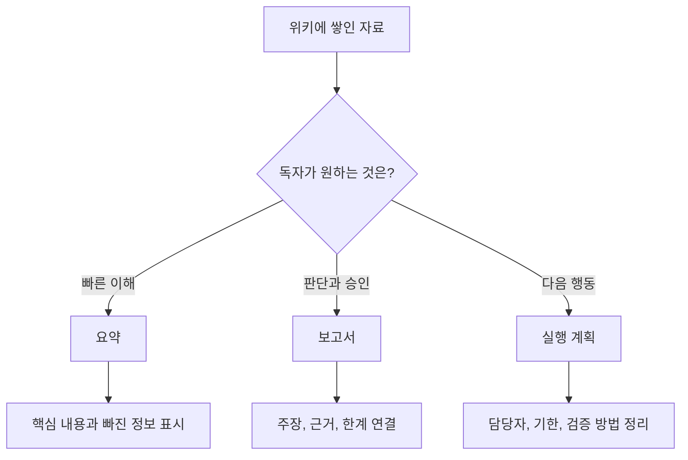
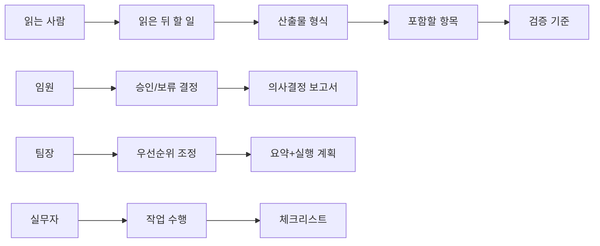
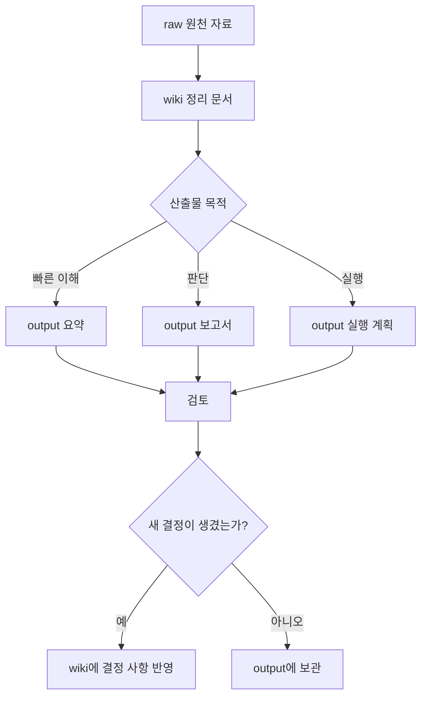

1. [**LLM위키 완벽 가이드**](https://wikidocs.net/book/19830)
2. [7장. 위키에서 업무 산출물 만들기](https://wikidocs.net/353401)
3. [7.1 산출물의 목적 정하기](https://wikidocs.net/353402)

1. [위키독스](https://wikidocs.net/)

# 7.1 산출물의 목적 정하기[맨위로](https://wikidocs.net/353402\#top "맨위로")

광고가 출력될 위치입니다.


광고가 출력될 위치입니다.


# 7.1 산출물의 목적 정하기


위키에 자료가 쌓이면 LLM에게 “이걸로 문서 하나 만들어 줘”라고 묻고 싶어집니다. 하지만 산출물의 목적을 정하지 않으면 결과는 쉽게 흐려집니다. 같은 위키를 보더라도 팀장에게 보낼 요약, 의사결정을 위한 보고서, 바로 실행할 계획은 서로 다른 모양이어야 합니다.

이 절에서는 위키에서 산출물을 만들기 전에 먼저 정해야 할 세 가지를 다룹니다. 무엇을 만들 것인지, 누가 읽을 것인지, 완성된 결과물을 어디에 남길 것인지입니다.

## 요약, 보고서, 실행 계획의 차이

요약, 보고서, 실행 계획은 모두 위키의 내용을 바탕으로 만들 수 있습니다. 그러나 목적이 다릅니다.

요약은 많은 내용을 짧게 줄여 핵심을 빠르게 파악하게 합니다. 보고서는 판단과 의사결정을 돕습니다. 실행 계획은 누가 무엇을 언제까지 할지 정합니다. 세 형식을 섞으면 독자가 필요한 행동을 놓치기 쉽습니다.

### 학습자료: 산출물 목적 비교표

| 산출물 | 핵심 질문 | 읽는 사람의 기대 | 위키에서 가져올 내용 | 결과물의 좋은 상태 |
| --- | --- | --- | --- | --- |
| 요약 | “무슨 내용인가?” | 빠른 이해 | 핵심 개념, 주요 사실, 반복 패턴 | 1~2분 안에 전체 흐름을 파악한다 |
| 보고서 | “그래서 어떻게 판단해야 하는가?” | 근거 있는 결론 | 주장, 근거, 한계, 선택지 | 결론과 근거가 연결되어 있다 |
| 실행 계획 | “이제 무엇을 할 것인가?” | 바로 움직일 수 있는 다음 행동 | 결정 사항, 제약, 담당 후보, 일정 | 담당자, 기한, 검증 방법이 있다 |

이 표는 산출물의 이름보다 목적을 먼저 보게 합니다. 예를 들어 “업무 자동화 보고서”라고 부르더라도 실제 독자가 원하는 것이 다음 주 할 일이라면 실행 계획에 가깝습니다. 반대로 “회의 요약”이라고 해도 결재를 받아야 한다면 보고서의 구조가 필요합니다.

### 예시: 같은 위키에서 다른 산출물 만들기

다음과 같은 LLM위키가 있다고 가정해 보겠습니다.

```text
work-automation-wiki/
  raw/
    meeting-2026-05-16.md
    support-log-sample.md
  wiki/
    inquiry-classification.md
    repeated-support-tasks.md
    automation-risk.md
  output/
```

이 위키의 주제는 “고객 문의 분류 자동화”입니다. 같은 자료를 보더라도 목적에 따라 산출물은 이렇게 달라집니다.

```markdown
요약:
고객 문의는 배송, 환불, 계정, 기타로 나뉘며 반복 문의의 비중이 높다.
현재 회의록 기준으로 배송 문의 자동 분류가 첫 실험 후보이다.

보고서:
고객 문의 자동화의 1차 대상은 배송 문의로 제안한다.
근거는 반복 빈도, 규칙의 명확성, 실패 시 대응 가능성이다.
다만 실제 고객 데이터의 개인정보 처리 기준은 추가 확인이 필요하다.

실행 계획:
1. 최근 2주 배송 문의 샘플 50건을 익명화한다.
2. 문의 유형 라벨 기준을 4개로 확정한다.
3. LLM 분류 결과와 사람이 분류한 결과를 비교한다.
4. 정확도와 실패 사례를 기준으로 2차 실험 여부를 결정한다.
```

세 문서는 모두 같은 위키에서 나올 수 있습니다. 그러나 독자가 얻는 것은 다릅니다. 요약은 이해를 돕고, 보고서는 판단을 돕고, 실행 계획은 행동을 만듭니다.

### 산출물 선택 흐름



이 흐름에서 중요한 지점은 “위키에 무엇이 있는가”보다 “독자가 무엇을 해야 하는가”입니다. 위키는 재료입니다. 산출물은 그 재료를 읽는 사람의 행동에 맞게 다시 배열한 결과입니다.

### 실습: 산출물 목적 한 줄로 정하기

**목표**

위키에서 만들 산출물의 목적을 한 문장으로 정합니다.

**실행 전제**

이미 정리된 위키 문서가 2~3개 있다고 가정합니다. 실제 파일이 없어도 자신의 업무 주제로 표를 채울 수 있습니다.

**성공 기준**

요약, 보고서, 실행 계획 중 하나를 고르고, 독자가 산출물을 읽은 뒤 해야 할 행동을 쓸 수 있으면 됩니다.

```markdown
| 항목 | 작성 내용 |
|---|---|
| 위키 주제 | 고객 문의 분류 자동화 |
| 만들 산출물 | 실행 계획 |
| 읽는 사람 | 고객지원팀 리더 |
| 읽은 뒤 해야 할 일 | 1차 실험 진행 여부를 결정하고 담당자를 지정한다 |
| 포함할 내용 | 실험 범위, 필요한 자료, 담당자, 일정, 성공 기준 |
| 제외할 내용 | LLM 일반 설명, 자동화 도구 비교 |
```

이 실습을 끝내면 LLM에게 산출물을 요청할 때 지시가 짧아집니다. “보고서 만들어 줘”가 아니라 “고객지원팀 리더가 1차 실험 여부를 결정할 수 있는 실행 계획을 만들어 줘”라고 말할 수 있습니다.

## 읽는 사람에 맞는 형식 고르기

산출물은 글쓴 사람이 아니라 읽는 사람을 기준으로 설계해야 합니다. 같은 내용도 대표, 팀장, 실무자, 외부 협력사가 읽을 때 필요한 형식이 달라집니다.

대표나 의사결정자는 긴 배경보다 결론과 리스크를 먼저 봅니다. 팀장은 우선순위와 자원 배분을 봅니다. 실무자는 입력 자료, 작업 순서, 검증 기준을 봅니다. 외부 협력사는 범위, 책임, 일정, 전달물을 봅니다.

### 학습자료: 독자별 산출물 형식

| 읽는 사람 | 먼저 보고 싶은 것 | 적합한 형식 | 피해야 할 것 |
| --- | --- | --- | --- |
| 대표, 임원 | 결론, 기대 효과, 리스크 | 1쪽 의사결정 보고서 | 세부 작업 로그부터 나열하기 |
| 팀장 | 우선순위, 일정, 필요한 사람 | 실행 계획이 포함된 보고서 | 근거 없는 낙관적 일정 |
| 실무자 | 작업 순서, 입력 자료, 검증 방법 | 체크리스트형 실행 계획 | 추상적인 방향성만 제시하기 |
| 동료 리뷰어 | 근거, 한계, 빠진 정보 | 근거 링크가 있는 검토용 문서 | 출처 없는 단정 |
| 외부 협력사 | 범위, 책임, 산출물 기준 | 작업 요청서 또는 공유용 요약 | 내부 약어와 맥락 없는 표현 |

이 표는 “누가 읽는가”에 따라 같은 위키 내용을 어떻게 바꿔야 하는지 보여 줍니다. LLM위키의 장점은 원천 자료와 정리 문서가 이미 남아 있다는 점입니다. 따라서 독자에 맞게 형식을 바꾸더라도 근거를 다시 찾을 수 있습니다.

### 예시: 독자별 요청 문장

LLM에게 산출물을 요청할 때는 독자와 용도를 함께 적습니다.

```text
나쁜 요청:
고객 문의 자동화 위키를 보고 보고서 써 줘.

좋은 요청:
wiki/ 아래 문서를 근거로 고객지원팀 리더가 읽을 1쪽 실행 계획을 작성해 줘.
목적은 배송 문의 자동 분류 실험을 다음 주에 시작할지 결정하는 것이다.
반드시 포함할 항목은 목표, 범위, 필요한 자료, 담당자 후보, 일정, 성공 기준, 확인 필요 사항이다.
근거가 부족한 내용은 단정하지 말고 "확인 필요"로 표시해 줘.
결과물은 output/customer-inquiry-pilot-plan.md 형식으로 작성한다고 가정해 줘.
```

좋은 요청은 길어 보이지만 실제로는 불필요한 왕복을 줄입니다. 특히 “읽는 사람”, “결정할 일”, “포함할 항목”, “확인 필요 표시”를 넣으면 산출물의 방향이 안정됩니다.

### 형식 선택 도해



이 도해는 형식이 취향의 문제가 아니라는 점을 보여 줍니다. 산출물 형식은 독자의 다음 행동에서 거꾸로 정합니다.

### 실습: 독자별 산출물 틀 만들기

**목표**

같은 위키 주제를 두고 독자별로 다른 산출물 틀을 만듭니다.

**실행 전제**

업무 주제 하나를 정합니다. 여기서는 “고객 문의 분류 자동화”를 예로 듭니다.

**성공 기준**

두 명 이상의 독자에 대해 산출물 제목, 포함할 항목, 제외할 항목을 쓸 수 있으면 됩니다.

```markdown
| 읽는 사람 | 산출물 제목 | 포함할 항목 | 제외할 항목 |
|---|---|---|---|
| 고객지원팀 리더 | 배송 문의 자동 분류 1차 실험 계획 | 목표, 범위, 일정, 담당자, 성공 기준, 리스크 | LLM 기술 일반론 |
| 실무 담당자 | 배송 문의 샘플 라벨링 체크리스트 | 샘플 기준, 라벨 정의, 예외 처리, 검증 방법 | 예산 승인 배경 |
| 임원 | 고객 문의 자동화 검토 요약 | 기대 효과, 필요한 결정, 리스크, 확인 필요 | 세부 파일 경로 |
```

이 표를 먼저 만들면 LLM에게 문서 작성을 맡기기 쉬워집니다. 위키의 자료를 모두 넣는 것이 아니라, 독자에게 필요한 자료만 고르게 되기 때문입니다.

## output 폴더를 쓰는 이유

LLM위키에서는 원천 자료와 정리된 지식, 업무 산출물을 구분하는 편이 안전합니다. 원천 자료는 `raw/`, 정리된 위키 문서는 `wiki/`, 외부에 공유하거나 실행에 쓰는 결과물은 `output/`에 둡니다.

`output/` 폴더는 단순한 저장 위치가 아닙니다. 위키에서 만든 결과물이 무엇인지, 언제 만들었는지, 어떤 근거를 사용했는지 추적하게 해 주는 공간입니다. 산출물을 위키 문서와 섞어 두면 나중에 원본인지 초안인지 최종본인지 구분하기 어려워집니다.

### 학습자료: 산출물 위치 구분

```text
work-automation-wiki/
  raw/
    meeting-2026-05-16.md
    support-log-sample.md
  wiki/
    repeated-support-tasks.md
    inquiry-classification.md
    automation-risk.md
  output/
    2026-05-16-customer-inquiry-summary.md
    2026-05-16-customer-inquiry-report.md
    2026-05-16-customer-inquiry-pilot-plan.md
```

이 구조에서 `raw/`는 원본 보관소입니다. `wiki/`는 LLM과 사람이 함께 정리한 지식층입니다. `output/`은 그 지식으로 만든 업무 결과물입니다.

파일 이름에 날짜와 목적을 넣으면 나중에 찾기 쉽습니다. 예를 들어 `customer-inquiry.md`보다 `2026-05-16-customer-inquiry-pilot-plan.md`가 더 안전합니다. 같은 주제로 요약, 보고서, 실행 계획이 여러 번 만들어질 수 있기 때문입니다.

### output 폴더의 세 가지 역할

| 역할 | 설명 | 예시 |
| --- | --- | --- |
| 결과물 분리 | 위키 문서와 공유 문서를 섞지 않는다 | `wiki/automation-risk.md`와 `output/risk-report.md` 분리 |
| 이력 관리 | 언제 어떤 목적으로 만들었는지 남긴다 | `2026-05-16-...` 파일명 |
| 검토 편의 | 제출 전 검토할 문서만 모아 본다 | 보고서 초안, 회의 자료, 실행 계획 |

`output/`에 있는 문서는 다시 위키의 근거가 될 수도 있습니다. 다만 그때도 조심해야 합니다. 산출물은 원본이 아니라 파생 결과입니다. 산출물에서 새 결정이 생겼다면 그 결정의 근거와 날짜를 위키에 다시 반영해야 합니다.

### 산출물 생성 흐름



이 흐름은 산출물을 만들고 끝내지 않습니다. 검토 과정에서 새 결정이나 수정된 기준이 생기면 `wiki/`로 되돌려야 합니다. 그래야 다음 산출물이 더 좋아집니다.

### 실습: output 폴더에 산출물 초안 만들기

**목표**

`output/` 폴더에 요약, 보고서, 실행 계획 초안 파일을 분리해 만듭니다.

**실행 전제**

macOS, Linux, WSL 또는 Bash를 사용할 수 있는 환경을 가정합니다. 이미 같은 실습 폴더가 있으면 `BASE` 값을 바꾼 뒤 실행합니다.

**성공 기준**

`output/` 아래에 목적이 다른 Markdown 파일 3개가 만들어지고, 각 파일에 근거 위치와 확인 필요 항목이 들어 있으면 됩니다.

```bash
BASE="$HOME/llm-wiki-output-demo"

if [ -e "$BASE" ]; then
  echo "이미 실습 폴더가 있습니다. BASE 값을 바꾸고 다시 실행하세요."
  exit 1
fi

mkdir -p "$BASE/raw" "$BASE/wiki" "$BASE/output"

printf '%s\n' \
'# 회의 원문 메모' \
'' \
'- 날짜: 2026-05-16' \
'- 주제: 고객 문의 분류 자동화' \
'- 반복 문의 중 배송 문의가 가장 먼저 실험하기 쉽다는 의견이 있었다.' \
'- 개인정보 처리 기준은 별도 확인이 필요하다.' \
> "$BASE/raw/meeting-2026-05-16.md"

printf '%s\n' \
'# 고객 문의 분류 자동화' \
'' \
'## 확인된 내용' \
'' \
'- 배송 문의는 1차 자동화 실험 후보이다.' \
'- 개인정보 처리 기준은 아직 확인되지 않았다.' \
'' \
'## 근거' \
'' \
'- raw/meeting-2026-05-16.md' \
> "$BASE/wiki/inquiry-classification.md"

printf '%s\n' \
'# 고객 문의 자동화 요약' \
'' \
'- 목적: 빠른 이해' \
'- 근거: wiki/inquiry-classification.md, raw/meeting-2026-05-16.md' \
'' \
'배송 문의는 고객 문의 자동화의 1차 실험 후보이다.' \
'다만 개인정보 처리 기준은 확인 필요이다.' \
> "$BASE/output/2026-05-16-customer-inquiry-summary.md"

printf '%s\n' \
'# 고객 문의 자동화 검토 보고서' \
'' \
'- 목적: 판단과 승인' \
'- 근거: wiki/inquiry-classification.md, raw/meeting-2026-05-16.md' \
'' \
'## 결론' \
'' \
'배송 문의 자동 분류를 1차 실험 후보로 검토한다.' \
'' \
'## 근거' \
'' \
'- 회의에서 배송 문의가 실험하기 쉽다는 의견이 있었다.' \
'' \
'## 확인 필요' \
'' \
'- 개인정보 처리 기준' \
'- 실제 문의 샘플의 사용 가능 여부' \
> "$BASE/output/2026-05-16-customer-inquiry-report.md"

printf '%s\n' \
'# 배송 문의 자동 분류 1차 실행 계획' \
'' \
'- 목적: 다음 행동 결정' \
'- 근거: wiki/inquiry-classification.md, raw/meeting-2026-05-16.md' \
'' \
'## 할 일' \
'' \
'1. 배송 문의 샘플 50건을 익명화한다.' \
'2. 라벨 기준을 배송, 환불, 계정, 기타로 임시 정의한다.' \
'3. 사람이 분류한 결과와 LLM 분류 결과를 비교한다.' \
'' \
'## 성공 기준' \
'' \
'- 샘플 50건 기준으로 실패 사례를 설명할 수 있다.' \
'' \
'## 확인 필요' \
'' \
'- 개인정보 처리 기준' \
'- 샘플 사용 승인' \
> "$BASE/output/2026-05-16-customer-inquiry-pilot-plan.md"

find "$BASE" -maxdepth 2 -type f | sort
```

예상 결과는 다음과 비슷합니다.

```text
/Users/사용자명/llm-wiki-output-demo/output/2026-05-16-customer-inquiry-pilot-plan.md
/Users/사용자명/llm-wiki-output-demo/output/2026-05-16-customer-inquiry-report.md
/Users/사용자명/llm-wiki-output-demo/output/2026-05-16-customer-inquiry-summary.md
/Users/사용자명/llm-wiki-output-demo/raw/meeting-2026-05-16.md
/Users/사용자명/llm-wiki-output-demo/wiki/inquiry-classification.md
```

이 실습은 같은 위키 지식에서 목적이 다른 세 문서를 만드는 연습입니다. 중요한 점은 세 파일 모두 `output/`에 있고, 근거가 `raw/`와 `wiki/`로 돌아간다는 것입니다.

### LLM에게 output 생성을 요청하는 틀

실제 LLM 도구를 쓸 때는 다음 틀을 사용할 수 있습니다.

```text
wiki/ 문서를 근거로 output/에 넣을 산출물 초안을 작성해 줘.

목적:
- 고객지원팀 리더가 배송 문의 자동 분류 실험을 시작할지 판단한다.

산출물 형식:
- 실행 계획

읽는 사람:
- 고객지원팀 리더

반드시 포함할 항목:
- 목표
- 실험 범위
- 필요한 자료
- 담당자 후보
- 일정
- 성공 기준
- 확인 필요 사항

작성 규칙:
- raw/와 wiki/에 근거가 있는 내용만 단정한다.
- 근거가 부족한 내용은 "확인 필요"로 표시한다.
- 파일명은 output/YYYY-MM-DD-customer-inquiry-pilot-plan.md 형식을 따른다.
```

이 요청은 특정 도구의 명령어가 아닙니다. Claude, Codex, 일반 LLM 도구에서 모두 응용할 수 있는 작성 지시입니다. 실제 파일 생성 기능은 사용하는 도구의 권한과 작업 방식에 따라 달라집니다.

## 7.1의 검증 포인트

산출물을 만들기 전에 다음 항목을 확인합니다.

| 점검 항목 | 확인 질문 |
| --- | --- |
| 목적 | 이 문서는 요약, 보고서, 실행 계획 중 무엇인가? |
| 독자 | 누가 읽고 어떤 결정을 해야 하는가? |
| 포함 범위 | 독자에게 필요한 내용만 담았는가? |
| 제외 범위 | 배경 설명이나 도구 설명이 과하게 들어가지 않았는가? |
| 근거 | 핵심 주장마다 `raw/` 또는 `wiki/`로 돌아갈 수 있는가? |
| 위치 | 공유하거나 실행할 결과물이 `output/`에 분리되어 있는가? |
| 확인 필요 | 근거가 부족한 내용을 단정하지 않았는가? |

이 절의 핵심은 “위키에서 문서를 만든다”가 아닙니다. “읽는 사람이 다음 행동을 할 수 있게 위키의 내용을 재배열한다”입니다. 목적이 분명하면 LLM에게 맡기는 일도 분명해집니다.

## 근거와 추가 확인

- Andrej Karpathy, “LLM Wiki” 아이디어 문서: https://gist.github.com/karpathy/442a6bf555914893e9891c11519de94f


확인 날짜: 2026-05-16. `raw sources`, `wiki`, `schema`를 나누는 LLM위키 패턴의 근거로 사용했습니다.

- `nvk/llm-wiki` 공식 저장소: https://github.com/nvk/llm-wiki


확인 날짜: 2026-05-16. LLM위키 구현체가 위키 자료와 산출물 생성을 연결한다는 점을 참고했습니다.

- `nvk/llm-wiki` Releases: https://github.com/nvk/llm-wiki/releases


확인 날짜: 2026-05-16. 구현체 명령과 기능은 빠르게 바뀔 수 있으므로, 이 절에서는 특정 `/wiki` 명령 실행 절차를 단정하지 않았습니다.

- WiCER 프리프린트: https://arxiv.org/abs/2605.07068


확인 날짜: 2026-05-16. LLM이 만든 위키와 산출물은 검증 없이 원본처럼 믿으면 위험하다는 제한적 근거로 참고했습니다. 프리프린트이므로 정설로 단정하지 않습니다.


마지막 편집일시 : 2026년 5월 16일 1:06 오후


광고가 출력될 위치입니다.


광고가 출력될 위치입니다.


댓글 0 [피드백](https://wikidocs.net/353402#myModal "피드백을 남겨주세요")

[※ 댓글 작성은 로그인이 필요합니다.](https://wikidocs.net/loginForm) [(또는 피드백을 이용해 주세요.)](https://wikidocs.net/353402#myModal)

- **이전글** : [7장. 위키에서 업무 산출물 만들기](https://wikidocs.net/353401)
- **다음글** : [7.2 업무 보고서 만들기](https://wikidocs.net/353403)